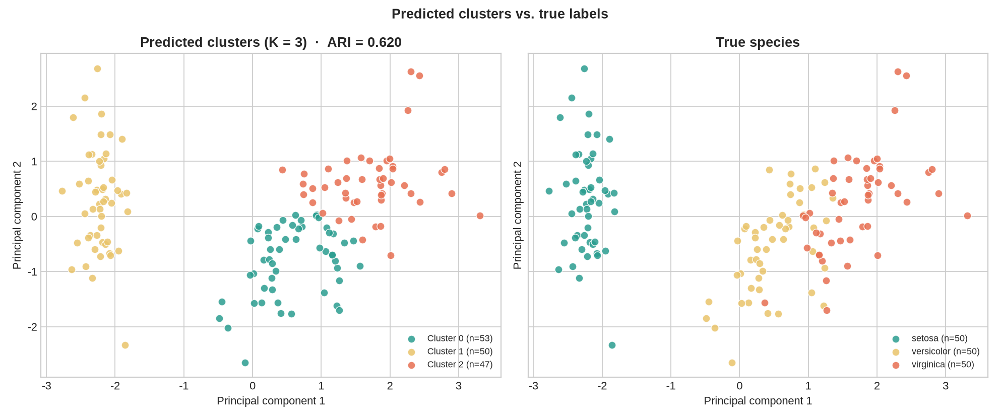

# Mini Project 3 — Iris Flower Clustering Project

Clustering the Iris dataset with **K-Means (K = 3)**, visualising the groups,
and comparing the unsupervised clusters with the true species labels.

**Dataset:** [Iris](https://archive.ics.uci.edu/dataset/53/iris) (UCI / Kaggle)
— 150 flowers, 4 measurements, 3 species (50 each).

**Script:** `iris_flower_clustering.py` · **Notebook:** `iris_flower_clustering.ipynb` · **Outputs:** `outputs/`

## Result

| Metric | Value |
|---|---:|
| Clusters | 3 |
| Silhouette score | 0.460 |
| Inertia | 139.82 |
| **Purity** | **83.3%** |
| **Accuracy after cluster→species mapping** | **83.3%** |
| Adjusted Rand Index (ARI) | 0.620 |
| Adjusted Mutual Information (AMI) | 0.655 |
| Normalised Mutual Information (NMI) | 0.659 |
| Homogeneity / Completeness / V-measure | 0.659 / 0.660 / 0.659 |
| Calinski–Harabasz | 241.90 |
| Davies–Bouldin (lower is better) | 0.834 |



**Contingency table** (rows = true species, columns = predicted cluster):

| species | cluster 0 | cluster 1 | cluster 2 |
|---|---:|---:|---:|
| setosa | 0 | **50** | 0 |
| versicolor | **39** | 0 | 11 |
| virginica | 14 | 0 | **36** |

The majority-vote mapping is `0 → versicolor`, `1 → setosa`, `2 → virginica`.

**Interpretation**

- K-Means finds **setosa perfectly** (50/50): it is compact and far from the
  other species in petal space.
- Versicolor and virginica overlap. The algorithm splits them into two groups
  of 53 and 47 flowers, but 11 versicolor are grouped with virginica and 14
  virginica with versicolor. This is the classic Iris boundary problem, not a
  bug in the code.
- The silhouette is highest at **K = 2** (0.582) because two broad groups
  (setosa vs. the rest) are the cleanest split. The project uses **K = 3**
  because there are three known species, and the elbow in inertia supports it.
- The purity of **83.3%** with no labels used during training is a strong
  unsupervised result.

## Pipeline

1. **Load** `../data/iris.csv` (150 × 4 features + species).
2. **Standardise** with `StandardScaler` (fit on all flowers — this is a
   descriptive clustering exercise, not a predictive train/test task).
3. **Choose K** with inertia (elbow) and silhouette over `K = 1…10`.
4. **Fit** `KMeans(n_clusters=3, n_init=10, random_state=42)`.
5. **Visualise** clusters in petal space and in a 2-D PCA projection, with
   centroids marked.
6. **Compare** predicted clusters with true species: contingency heatmap,
   ARI, AMI, NMI, homogeneity, completeness, V-measure and purity.
7. **Persist** the scaler + model bundle with both **joblib** and **pickle**.
8. **Reload both copies** and verify that they reproduce the original 150
   predictions exactly; classify a new flower with the loaded model.

## Model saving / loading

The saved bundle contains the fitted `StandardScaler`, the `KMeans` model, the
feature list and the cluster→species mapping:

```python
from joblib import load
import pandas as pd

bundle = load("outputs/kmeans_model.joblib")
flower = pd.DataFrame([[5.0, 3.4, 1.5, 0.2]], columns=bundle["features"])
cluster = bundle["model"].predict(bundle["scaler"].transform(flower))[0]
print(cluster, bundle["cluster_to_species"][int(cluster)])   # 1 setosa
```

The same round-trip is demonstrated with `pickle` (`kmeans_model.pkl`). Both
formats reproduce the training predictions exactly. joblib is preferred for
NumPy-heavy scikit-learn objects; pickle is the standard-library fallback.

## Outputs

| File | Description |
|---|---|
| `elbow_method.png` | Inertia + silhouette vs K, with K=3 marked |
| `clusters_scatter.png` | Clusters + centroids in petal space and PCA space |
| `predicted_vs_true.png` | Predicted clusters next to true species (PCA space) |
| `cluster_comparison_heatmap.png` | Contingency table heatmap |
| `cluster_profiles.png` | Mean measurements per cluster |
| `clustered_iris.csv` | All 150 flowers + `cluster` + `cluster_species` |
| `cluster_profiles.csv` | Cluster sizes, mapped species, mean measurements |
| `cluster_centroids.csv` | Centroids in original centimetres |
| `kmeans_model.joblib` | Portable model bundle (joblib) |
| `kmeans_model.pkl` | Portable model bundle (pickle) |
| `metrics.json` | Every metric + elbow table + persistence check |
| `model_card.txt` | Human-readable summary of the model |

## How to run

From the repository root (`WEEK3/`):

```bash
python "Iris Flower Clustering Project/iris_flower_clustering.py"
```

Or open the executed notebook for the same analysis with inline plots:

```bash
jupyter notebook "Iris Flower Clustering Project/iris_flower_clustering.ipynb"
```

The notebook is already executed, so every table and figure is visible without
running anything. If Jupyter asks for a kernel, choose **Python 3**.

## Notes

- Species labels are used **only for evaluation**, never for fitting. K-Means
  is unsupervised.
- `random_state=42` and `n_init=10` make the result reproducible.
- Scaling is essential: petal length ranges 1.0–6.9 cm while petal width ranges
  0.1–2.5 cm. Without scaling, the distance metric is dominated by the
  larger-range features.
